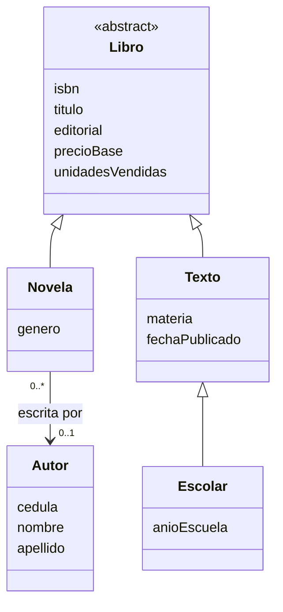
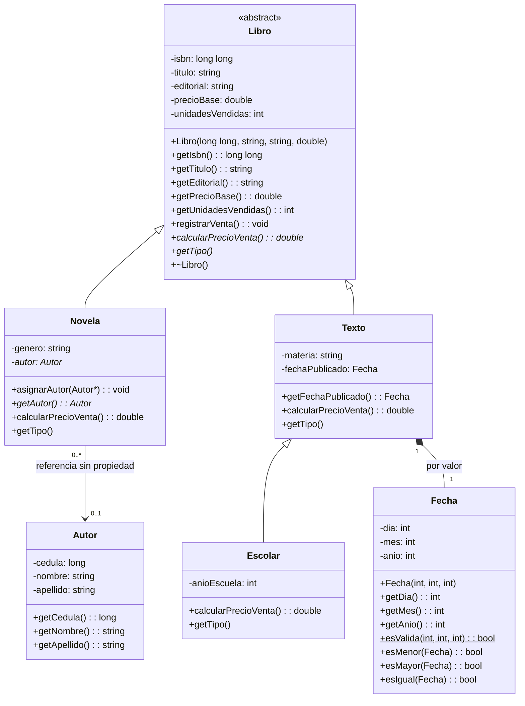
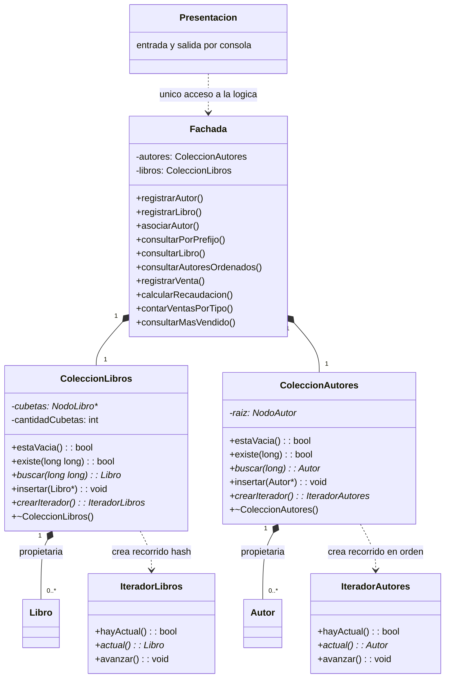
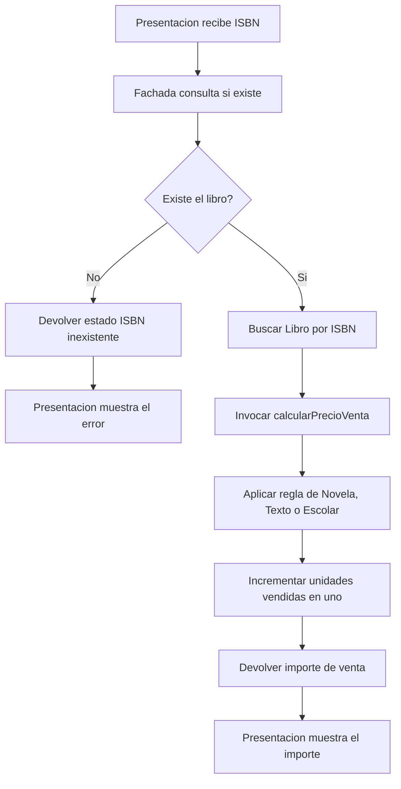

# Obligatorio P4 · Librería

Prototipo en C++ para gestionar libros de autores nacionales, autores de novelas
y ventas. Este README reúne el diseño propuesto y el plan de trabajo del equipo.

> **Estado:** `Fecha` está implementada y tiene pruebas. Las demás clases tienen
> archivos reservados; los diagramas describen el diseño objetivo, todavía pendiente
> de implementación. No representan funcionalidades terminadas.

## Guía del documento

- [Análisis: qué representa el sistema](#análisis-qué-representa-el-sistema)
- [Diseño: cómo se organiza el código](#diseño-cómo-se-organiza-el-código)
- [Colecciones y estructuras](#colecciones-y-estructuras)
- [Flujo de una venta](#flujo-de-una-venta)
- [Memoria y precondiciones](#memoria-y-precondiciones)
- [Compilación y pruebas](#compilación-y-pruebas)
- [Plan por fases](#plan-por-fases-para-tres-integrantes-sin-fechas)

## Análisis: qué representa el sistema

El diagrama de clases conceptual representa las entidades y sus relaciones.
En esta etapa no aparecen hash, ABB, punteros ni la Fachada. `Libro` es abstracta:
los libros del sistema son novelas o textos; un escolar es un tipo de texto.



Un autor puede estar registrado sin novelas. Una novela puede no tener autor
asociado o tener uno; reemplazar esa asociación no elimina al autor anterior.
No se gestionan clientes, empleados, stock ni respaldo en disco.

## Diseño: cómo se organiza el código

El diagrama de clases de implementación propuesto incorpora tipos, operaciones,
colecciones y la Fachada. Se divide en dos vistas para facilitar su lectura.
Las firmas que aún no existen en código son propuestas para acordar entre los tres.
`ISBN` se representará con `long long` y la cédula con `long`; los textos del dominio
usarán `std::string`. `Fecha` contiene únicamente tres enteros.

### Entidades y polimorfismo



Los métodos abstractos se representan en cursiva y los estáticos subrayados.
Son conceptos del teórico; los símbolos usados para generar ese formato pertenecen
al código fuente de Mermaid, no a la notación que se lee en el diagrama.
`Libro` tendrá destructor virtual, para liberar correctamente objetos derivados
mediante un puntero a la clase base. Los atributos privados se indican con `-`
y los métodos públicos, incluidos constructores y destructores, con `+`.
Los parámetros se muestran solo con sus tipos. Los métodos con retorno se
escriben como `+metodo(tipos): tipoRetorno`; constructores y destructores no
llevan tipo de retorno. En la implementación C++ sí se nombran los parámetros.
El destructor de Libro es público y virtual; los destructores de las colecciones
son públicos. El signo de visibilidad no indica si un método es virtual.


El tipo del resultado de `getTipo()` queda pendiente de acordar con el equipo;
no se incorpora una enumeración como decisión cerrada. En esta vista se muestra
solo el nombre de esa operación. También falta completar los constructores y las
consultas de atributos propios antes de considerar terminado el diseño UML.

| Tipo | Regla de precio de venta |
| --- | --- |
| Novela | Precio base; si el género es infantil, multiplicar por 0,80. |
| Texto | Si fue publicado antes del 01/01/2026, multiplicar el precio base por 0,75. En otro caso, usar el precio base. |
| Escolar | Aplicar el cálculo de Texto; para 1.º a 3.º, multiplicar además por 0,90. |

### Colecciones y acceso a la lógica



Las operaciones de Fachada se muestran por nombre: sus parámetros y resultados
se acordarán antes de implementarlas. Deben devolver datos o estados de error;
no leen teclado ni imprimen mensajes. Esta vista no es aún una especificación UML
completa lista para entregar.

## Colecciones y estructuras

Un **TAD** describe operaciones; una **estructura de datos** permite implementarlas.
La colección encapsula su estructura privada. No hace falta que la colección sea
una clase abstracta ni introducir una biblioteca genérica con `templates`.

| Colección | TAD e implementación | Justificación |
| --- | --- | --- |
| Libros | Diccionario por ISBN, hash con encadenamiento | Aproximadamente 500 títulos; búsquedas frecuentes para registrar, asociar autor, consultar y vender (2, 3, 5 y 7). Búsqueda e inserción esperadas O(1) con buena dispersión y carga controlada; peor caso O(n). |
| Autores | Diccionario por cédula, ABB | Cantidad sin cota; búsqueda por cédula y listado ascendente (1, 3 y 6). Búsqueda e inserción O(h), peor caso O(n); recorrido en orden O(n). |

Los 500 títulos son una estimación, no una capacidad máxima. Las cadenas resuelven
colisiones y admiten más elementos. El recorrido completo del hash cuesta
O(n + cantidad de cubetas). El dimensionamiento y eventual crecimiento de la tabla
se fijarán al implementarla.

**ABB es suficiente para esta propuesta:** la letra no exige búsquedas O(log n).
Puede degenerarse con claves ordenadas; AVL garantizaría O(log n), pero requiere
balanceos que no son necesarios para satisfacer los requerimientos.

No se agregan índices por editorial, precio o prefijo: esas consultas pueden recorrer
los libros. Una lista como colección principal haría lineales las búsquedas por
clave. Tampoco hace falta una lista circular para los recorridos finitos pedidos.
En el teórico, LPPF se usa como secuencia con inserción por el final; aquí no hay
un requerimiento que justifique agregar esa secuencia como colección adicional.

**Iteradores:** permiten recorrer sin exponer nodos. El de libros recorre cubetas
y cadenas; el de autores recorre el ABB en orden. No necesitan una jerarquía
abstracta propia para esta primera implementación.

> Hay archivos vacíos reservados con los nombres `HashLibros`, `ABBAutores`,
> `IteradorHashLibros` e `IteradorABBAutores` de una propuesta anterior.
> El diseño simplificado integra esas estructuras en las colecciones e iteradores
> específicos; esos archivos no representan clases adicionales obligatorias.
> Su eliminación o reutilización queda pendiente de acordar, sin cambiar código aquí.

## Flujo de una venta

Ejemplo del requerimiento 7: la presentación recibe el ISBN; la Fachada valida,
la colección busca y el libro calcula el precio mediante polimorfismo.



## Memoria y precondiciones

| Elemento | Representación y responsabilidad |
| --- | --- |
| Fecha | Objeto por valor dentro de Texto; no requiere memoria dinámica. |
| Libros | `Libro*` para conservar el polimorfismo. La colección los elimina mediante destructor virtual. |
| Autores | `Autor*` propiedad de su colección. |
| Autor de Novela | Puntero inicialmente nulo, sin propiedad. Reasignarlo no copia ni elimina al autor. |
| Nodos y cubetas | Privados de cada colección; se liberan al destruirla. |
| Iteradores | No poseen los objetos recorridos; quien crea el iterador debe liberarlo. No modificar la colección durante el recorrido. |

Al finalizar se destruyen libros antes que autores. Las colecciones propietarias
no deben copiarse sin definir una política de copia, para evitar dobles liberaciones.
No habrá bajas durante la ejecución, como establece la letra.

### Qué destructores necesitamos

Todas las clases tienen destructor, aunque C++ puede generarlo automáticamente.
Declarar uno propio es necesario cuando debe realizar trabajo específico o ser virtual.

| Clase | Destructor propio en este diseño | Responsabilidad |
| --- | --- | --- |
| Libro | Sí: público y virtual | Permitir `delete` seguro mediante `Libro*`. Su cuerpo puede estar vacío. |
| ColeccionLibros | Sí: público | Eliminar cada libro una vez, los nodos de las cadenas y el arreglo dinámico de cubetas con `delete[]`. |
| ColeccionAutores | Sí: público | Eliminar los nodos del ABB y cada Autor una vez, mediante recorrido postorden. |
| Novela | No requiere uno escrito a mano | El destructor generado es virtual por Libro. Nunca debe eliminar su `Autor*`, que pertenece a la colección de autores. |
| Texto y Escolar | No requieren uno escrito a mano | Sus miembros por valor se destruyen automáticamente; el destructor sigue siendo virtual por herencia. |
| Autor | No requiere uno escrito a mano | Sus enteros y `std::string` se gestionan automáticamente. |
| Fecha | No requiere uno escrito a mano | Solo contiene tres enteros. |
| Fachada | No requiere uno escrito a mano con colecciones por valor | Sus colecciones se destruyen automáticamente en orden inverso a su declaración. Declarar autores antes que libros para destruir libros primero. No ejecutar `delete` sobre esos miembros. |
| IteradorLibros | Depende de su representación | Si solo referencia cubetas y nodos ajenos, alcanza el destructor generado; nunca elimina los libros ni las cubetas. |
| IteradorAutores | Depende de su representación | Si usa una pila dinámica propia para el recorrido en orden, debe liberar esa pila, sin eliminar autores ni nodos del ABB. Si usa solo referencias ajenas, no necesita liberación propia. |

La necesidad de liberar los iteradores creados con `new` es independiente de si
su destructor tiene cuerpo propio. Si finalmente se añaden recursos dinámicos
propios a una clase, debe revisarse esta tabla y su política de copia.

Las precondiciones se documentarán en los `.h` con `// PRECONDICION:` y una lista
numerada cuando haya varias. La Fachada debe validar la entrada antes de delegar
una operación que presuponga esos controles.

| Operación | Precondición |
| --- | --- |
| `Fecha(dia, mes, anio)` | La fecha es válida; año entre 1 y 9999. Validar con `Fecha::esValida` antes de construir. |
| Comparaciones de Fecha | Ambas fechas son válidas. |
| `buscar(clave)` | La clave existe. |
| `insertar(puntero)` | Puntero válido; clave no repetida; se transfiere la propiedad a la colección. |
| `actual()` y `avanzar()` | `hayActual()` devuelve verdadero. |

## Compilación y pruebas

```text
include/      Encabezados .h
src/          Implementaciones .cpp; main del programa aún vacío
tests/        Main independiente para pruebas
.github/      Workflow de compilación, pruebas y cobertura
```

Desde la terminal de Visual Studio Code, ejecutar las pruebas actuales:

```sh
mkdir -p build
g++ -std=c++11 -Wall -Wextra -pedantic -Iinclude src/Fecha.cpp tests/main.cpp -o build/p4_tests
./build/p4_tests
```

La CI ejecuta las pruebas y exige 90% de cobertura de líneas sobre el código de
`src/` que se compila e instrumenta. Hoy solo se compila `Fecha.cpp`.
Cada implementación nueva debe incorporarse al comando de compilación junto con
sus pruebas para que entre en la medición; reservar un archivo no aporta cobertura.
La configuración de Code::Blocks para la entrega todavía está pendiente.

## Plan por fases para tres integrantes (sin fechas)

Se identifican como A, B y C hasta asignar nombres. Cada entrega incluye sus
pruebas y se integra mediante PR a develop. Se comienza una rama por entregable
a partir de develop actualizado. No se trabaja directamente en develop.

| Fase | Integrante A | Integrante B | Integrante C | Condicion para cerrar la fase |
| --- | --- | --- | --- | --- |
| 1. Acuerdos y base | Fecha: validacion y comparaciones | Autor: datos y consultas | Libro: datos comunes y contrato de precio | Acordar firmas, tipos de claves, resultados de error y propiedad de punteros; probar las tres clases |
| 2. Trabajo paralelo | Novela, Texto y Escolar: precios, fecha y asociacion con Autor | ColeccionAutores con ABB y su iterador | ColeccionLibros con hash y su iterador | Compilar las interfaces acordadas; probar descuentos, orden, duplicados, colisiones y recorridos |
| 3. Operaciones de logica | Consultas de libros: prefijo y detalle (4 y 5) | Registro de autores y listado ordenado (1 y 6) | Registro de libros y asociacion de autor (2 y 3) | Probar operaciones vacias, claves inexistentes y resultados correctos |
| 4. Ventas y consultas agregadas | Ventas y precio final (7) | Recaudacion por editorial y libro mas vendido (8 y 10) | Unidades vendidas por precio y tipo (9) | Probar ventas sucesivas, tipos de libro, ausencia de editorial y empates |
| 5. Integracion y entrega | Main, entrada y mensajes | UML y justificacion de estructuras y memoria | Proyecto Code::Blocks y revision del paquete | Los diez requerimientos funcionan, CI pasa con cobertura minima 90%, documentos y codigo coinciden |

### Como evitar bloqueos y conflictos

- Antes de la fase 2, cerrar juntos las interfaces de Libro, Autor, colecciones
  e iteradores. Los nombres y tipos deben coincidir en las tres ramas.
- Cada integrante implementa contra esos contratos; los cambios de interfaz se
  acuerdan y se integran primero mediante un PR pequeno.
- En fases 3 y 4, escribir y probar cada operacion en el modulo que posee sus
  datos. Un responsable de integracion por fase conecta las llamadas en Fachada:
  A en fase 3 y C en fase 4. Asi no se editan simultaneamente sus mismos metodos.
- Los metodos de Fachada se acuerdan antes de comenzar esas fases. La logica no
  debe depender del menu: el main se conecta al final.
- Agregar pruebas en archivos separados por modulo y mantener un unico main de
  pruebas que las invoque. Actualizar el comando de CI al incorporar archivos
  con implementacion y nuevas pruebas; los archivos reservados vacios no bastan.
- Cada PR debe incluir alcance, precondiciones y pruebas. Otra persona lo revisa;
  la regla obligatoria de aprobacion se activara despues del primer merge acordado.
- Una fase no exige que todos terminen al mismo tiempo: se puede comenzar una
  tarea cuando sus dependencias esten integradas y probadas.

### Criterios de aceptacion por funcionalidad

| Requerimiento | Entregable comprobable |
| --- | --- |
| 1 | Registra autor; rechaza cedula repetida sin modificar la coleccion |
| 2 | Registra cada tipo de libro con cero ventas; rechaza ISBN repetido |
| 3 | Asocia y reemplaza autor; informa claves inexistentes y verifica que sea novela |
| 4 | Filtra por prefijo exacto del titulo y produce datos basicos; detecta resultado vacio |
| 5 | Consulta datos completos por ISBN e incluye autor cuando corresponda |
| 6 | Recorre autores por cedula ascendente; detecta coleccion vacia |
| 7 | Incrementa una venta y devuelve el precio con sus descuentos; rechaza ISBN inexistente |
| 8 | Suma unidades vendidas por precio de venta para la editorial consultada |
| 9 | Suma unidades, no titulos, con precio base estrictamente mayor; separa los tres tipos |
| 10 | Obtiene un libro con ventas maximas de la editorial, incluye detalle y autor; admite cualquier empate |

La eleccion inicial para autores es ABB: la letra no exige operaciones O(log n).
AVL queda como mejora posible, fuera del alcance inicial, si se decide garantizar
ese costo aun con cedulas insertadas en orden.
