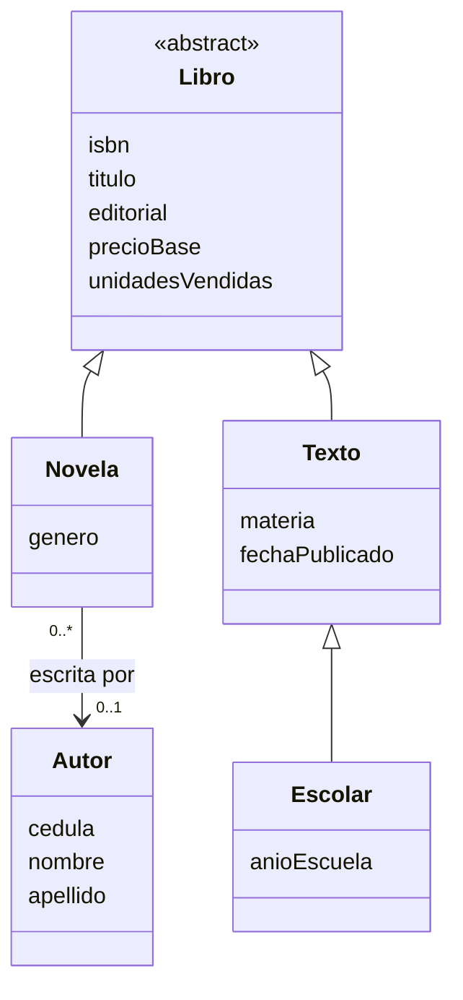
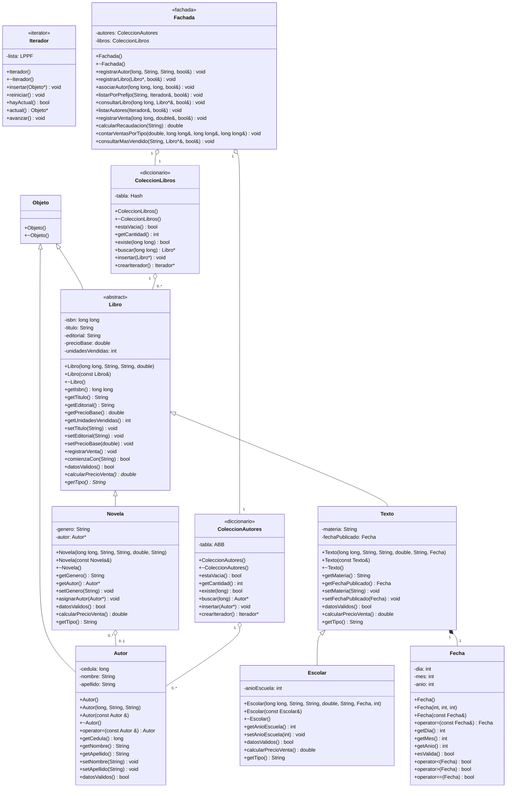

# Obligatorio P4 · Librería

## 1. Diagrama de análisis

Diagrama conceptual provisto por la letra, expresado en Mermaid.



## 2. Elección del diseño y de los TAD

```text
Libros = Diccionario (Libro)
Libro = isbn x titulo x editorial x precioBase x unidadesVendidas
Autores = Diccionario (Autor)
Autor = cedula x nombre x apellido
Novela = Libro + (genero x Autor) 
Texto = (materia x fechaPublicado) + Libro
Escolar = anioEscuela + Texto
```

`x` combina atributos. `+ Libro` y `+ Texto` representan la herencia de la clase
base. El Autor de una Novela es una referencia opcional a un autor registrado:
puede no estar asociado, y un mismo autor puede estar referenciado por varias novelas.

| Elección | Justificación |
| --- | --- |
| Libros como Diccionario (Libro) | Cada libro se identifica por un ISBN único. Se necesita comprobar pertenencia, insertar sin duplicados y recuperar por esa clave. No se pide conservar el orden de registro. |
| Autores como Diccionario (Autor) | Cada autor se identifica por una cédula única. Se necesita comprobar pertenencia, registrar y buscar por cédula. La cantidad de autores no tiene cota y pueden existir autores sin novelas asociadas. |
| Novela como especialización de Libro | Comparte los atributos comunes del libro y agrega género y referencia opcional a Autor. Define su cálculo particular del precio. |
| Texto como especialización de Libro | Comparte los atributos comunes y agrega materia y fecha de publicación, necesaria para su descuento. |
| Escolar como especialización de Texto | Conserva materia y fecha, agrega año de escuela y amplía la regla de precio del texto común. |
| Recorrido como Secuencia (Objeto) | Los resultados se recorren en el orden en que se cargan. La base Objeto permite guardar referencias a libros o autores en un mismo tipo de iterador, sin duplicar las entidades. |

Libro y Autor heredan de Objeto para reutilizar el recorrido. Eso no significa
que Autor sea un Libro. Libros y Autores se representan en código con las clases
ColeccionLibros y ColeccionAutores.

## 3. Elección de estructuras para los TAD

| TAD | Estructura elegida | Justificación |
| --- | --- | --- |
| Diccionario de libros | Hash con listas simplemente enlazadas por cubeta | Hay aproximadamente 500 títulos y se consulta frecuentemente por ISBN. Con buena dispersión y carga controlada, buscar e insertar tiene costo esperado O(1); el peor caso es O(n). Las listas resuelven colisiones sin fijar un máximo de libros. |
| Diccionario de autores | ABB por cédula | Permite buscar por cédula y obtener el listado ascendente mediante recorrido en orden. Buscar e insertar cuesta O(h); puede llegar a O(n) si el árbol se degenera. El listado completo cuesta O(n). |
| Secuencia de referencias del iterador | LPPF | Agregar al final cuesta O(1) y conserva el orden de carga, especialmente el orden ascendente de los autores. Cada avance cuesta O(1), sin necesitar una capacidad máxima. |

El hash actual tiene 1009 cubetas y dispersa con ISBN % 1009. Los 500 títulos son
una estimación, no una capacidad máxima. Recorrer todas las cubetas cuesta
O(n + cantidad de cubetas). Las listas de colisiones insertan al principio;
no necesitan un enlace hacia atrás, un puntero al fondo ni circularidad.

AVL sería una alternativa para garantizar búsquedas O(log n), pero la letra no
impone ese costo. Se elige ABB por su implementación más simple. No se agregan
índices por editorial, precio ni prefijo: esas consultas recorren el diccionario
de libros. Una lista circular o doblemente enlazada no aporta operaciones que
necesiten estos recorridos finitos.

En el diagrama, las colecciones tienen los atributos `tabla: Hash` y `tabla: ABB`.
Las estructuras se implementan en HashLibros y ABBAutores, separadas de las
colecciones. Cada una encapsula su struct Nodo: el hash contiene una tabla de
punteros a listas; el ABB contiene una raíz con hijos izquierdo y derecho.
El iterador guarda referencias Objeto* en sus propios nodos de LPPF.

Las estructuras son propietarias de libros y autores y los eliminan una sola vez
al finalizar. Novela no elimina al autor compartido y el iterador solo elimina
sus nodos auxiliares. Se destruyen primero libros y después autores.

## 4. Especificación y desglose de requerimientos

Los requerimientos se toman de la letra. Cada ficha presenta entrada, salida y
proceso. La Fachada coordina los chequeos y devuelve los resultados; la capa de
presentación muestra los mensajes y listados. Los recorridos no duplican objetos.
En todos los requerimientos se asume que los datos de entrada son válidos según
su dominio. El desglose conserva los chequeos de existencia, duplicados y resultados
vacíos pedidos por la letra; no agrega validaciones de formato ni de rangos.

### Requerimiento 1

| Campo | Especificación |
| --- | --- |
| **Descripción** | Registrar un nuevo autor, comprobando que no exista otro con la misma cédula. Si existe, cancelar el registro e informar un error. |
| **Entrada** | Cédula, nombre y apellido del nuevo autor. |
| **Salida** | Autor registrado, o error por cédula repetida. |
| **Proceso** | Consultar si la cédula pertenece al diccionario de autores.<br><strong>Si ya existe entonces</strong><br>&nbsp;&nbsp;&nbsp;&nbsp;Informar error: ya existe un autor con esa cédula.<br><strong>Sino</strong><br>&nbsp;&nbsp;&nbsp;&nbsp;Crear el autor con los datos recibidos.<br>&nbsp;&nbsp;&nbsp;&nbsp;Insertarlo en el diccionario de autores.<br>&nbsp;&nbsp;&nbsp;&nbsp;Devolver confirmación de registro.<br><strong>Fin</strong> |

### Requerimiento 2

| Campo | Especificación |
| --- | --- |
| **Descripción** | Registrar un nuevo libro, comprobando que no exista otro con el mismo ISBN. Si existe, cancelar el registro e informar un error. Si se registra, inicializar sus unidades vendidas en cero. |
| **Entrada** | ISBN, título, editorial, precio base y tipo de libro. Para novela: género. Para texto: materia y fecha de publicación. Para escolar: además, año de escuela. |
| **Salida** | Libro registrado con cero unidades vendidas, o error por ISBN repetido. |
| **Proceso** | Consultar si el ISBN pertenece al diccionario de libros.<br><strong>Si ya existe entonces</strong><br>&nbsp;&nbsp;&nbsp;&nbsp;Informar error: ya existe un libro con ese ISBN.<br><strong>Sino</strong><br>&nbsp;&nbsp;&nbsp;&nbsp;Crear una Novela, un Texto o un Escolar según el tipo recibido.<br>&nbsp;&nbsp;&nbsp;&nbsp;Inicializar las unidades vendidas en cero.<br>&nbsp;&nbsp;&nbsp;&nbsp;<strong>Si es una novela entonces</strong><br>&nbsp;&nbsp;&nbsp;&nbsp;&nbsp;&nbsp;&nbsp;&nbsp;Inicializar su referencia al autor sin asociación.<br>&nbsp;&nbsp;&nbsp;&nbsp;<strong>Fin</strong><br>&nbsp;&nbsp;&nbsp;&nbsp;Insertar el libro en el diccionario de libros.<br>&nbsp;&nbsp;&nbsp;&nbsp;Devolver confirmación de registro.<br><strong>Fin</strong> |

### Requerimiento 3

| Campo | Especificación |
| --- | --- |
| **Descripción** | Dados el ISBN de una novela y la cédula de un autor, asociar dicho autor a esa novela. Si alguno no existe, informar un error. Si ya tenía un autor asociado, reemplazarlo. |
| **Entrada** | ISBN de la novela y cédula del autor. |
| **Salida** | Autor asociado a la novela, o error por ISBN o cédula inexistentes. |
| **Proceso** | Consultar si el ISBN pertenece al diccionario de libros.<br><strong>Si no existe entonces</strong><br>&nbsp;&nbsp;&nbsp;&nbsp;Informar error: no existe una novela con ese ISBN.<br><strong>Sino</strong><br>&nbsp;&nbsp;&nbsp;&nbsp;Consultar si la cédula pertenece al diccionario de autores.<br>&nbsp;&nbsp;&nbsp;&nbsp;<strong>Si no existe entonces</strong><br>&nbsp;&nbsp;&nbsp;&nbsp;&nbsp;&nbsp;&nbsp;&nbsp;Informar error: no existe un autor con esa cédula.<br>&nbsp;&nbsp;&nbsp;&nbsp;<strong>Sino</strong><br>&nbsp;&nbsp;&nbsp;&nbsp;&nbsp;&nbsp;&nbsp;&nbsp;Obtener la novela del diccionario de libros.<br>&nbsp;&nbsp;&nbsp;&nbsp;&nbsp;&nbsp;&nbsp;&nbsp;Obtener el autor del diccionario de autores.<br>&nbsp;&nbsp;&nbsp;&nbsp;&nbsp;&nbsp;&nbsp;&nbsp;Asignar el autor obtenido a la novela.<br>&nbsp;&nbsp;&nbsp;&nbsp;&nbsp;&nbsp;&nbsp;&nbsp;Devolver confirmación de la asociación.<br>&nbsp;&nbsp;&nbsp;&nbsp;<strong>Fin</strong><br><strong>Fin</strong> |

### Requerimiento 4

| Campo | Especificación |
| --- | --- |
| **Descripción** | Dada una frase, obtener un listado básico de los libros cuyo título comienza exactamente con esa frase. Mostrar ISBN, título y tipo, sin un orden particular. Si no hay coincidencias, informar un error. |
| **Entrada** | Frase con la que debe comenzar el título. |
| **Salida** | Listado de ISBN, título y tipo de cada libro coincidente, con los datos de un mismo libro en una línea; o error si no hay resultados. |
| **Proceso** | Obtener del diccionario los libros cuyos títulos comienzan exactamente con la frase.<br><strong>Si no hay libros coincidentes entonces</strong><br>&nbsp;&nbsp;&nbsp;&nbsp;Informar error: ningún título comienza con esa frase.<br><strong>Sino</strong><br>&nbsp;&nbsp;&nbsp;&nbsp;Devolver el listado básico con ISBN, título y tipo de cada libro.<br><strong>Fin</strong> |

### Requerimiento 5

| Campo | Especificación |
| --- | --- |
| **Descripción** | Dado un ISBN, listar todos los datos del libro correspondiente, incluido su tipo. Si es una novela con autor asociado, listar también los datos de ese autor. Si el ISBN no existe, informar un error. |
| **Entrada** | ISBN del libro. |
| **Salida** | Datos completos del libro y de su autor cuando corresponda, o error por ISBN inexistente. |
| **Proceso** | Consultar si el ISBN pertenece al diccionario de libros.<br><strong>Si no existe entonces</strong><br>&nbsp;&nbsp;&nbsp;&nbsp;Informar error: no existe un libro con ese ISBN.<br><strong>Sino</strong><br>&nbsp;&nbsp;&nbsp;&nbsp;Obtener el libro del diccionario.<br>&nbsp;&nbsp;&nbsp;&nbsp;Preparar ISBN, título, editorial, precio base, unidades vendidas y tipo.<br>&nbsp;&nbsp;&nbsp;&nbsp;<strong>Si es una novela entonces</strong><br>&nbsp;&nbsp;&nbsp;&nbsp;&nbsp;&nbsp;&nbsp;&nbsp;Agregar el género.<br>&nbsp;&nbsp;&nbsp;&nbsp;&nbsp;&nbsp;&nbsp;&nbsp;<strong>Si tiene autor asociado entonces</strong><br>&nbsp;&nbsp;&nbsp;&nbsp;&nbsp;&nbsp;&nbsp;&nbsp;&nbsp;&nbsp;&nbsp;&nbsp;Obtener su autor y agregar cédula, nombre y apellido.<br>&nbsp;&nbsp;&nbsp;&nbsp;&nbsp;&nbsp;&nbsp;&nbsp;<strong>Fin</strong><br>&nbsp;&nbsp;&nbsp;&nbsp;<strong>Sino</strong><br>&nbsp;&nbsp;&nbsp;&nbsp;&nbsp;&nbsp;&nbsp;&nbsp;Agregar materia y fecha de publicación del texto.<br>&nbsp;&nbsp;&nbsp;&nbsp;&nbsp;&nbsp;&nbsp;&nbsp;<strong>Si es escolar entonces</strong><br>&nbsp;&nbsp;&nbsp;&nbsp;&nbsp;&nbsp;&nbsp;&nbsp;&nbsp;&nbsp;&nbsp;&nbsp;Agregar el año de escuela.<br>&nbsp;&nbsp;&nbsp;&nbsp;&nbsp;&nbsp;&nbsp;&nbsp;<strong>Fin</strong><br>&nbsp;&nbsp;&nbsp;&nbsp;<strong>Fin</strong><br>&nbsp;&nbsp;&nbsp;&nbsp;Devolver los datos para que la presentación los muestre.<br><strong>Fin</strong> |

### Requerimiento 6

| Campo | Especificación |
| --- | --- |
| **Descripción** | Listar todos los datos de los autores registrados, ordenados por cédula de menor a mayor. Si no hay autores registrados, informar un error. |
| **Entrada** | No requiere datos de entrada. |
| **Salida** | Listado de cédula, nombre y apellido de todos los autores en orden ascendente, con un autor por línea; o error si la colección está vacía. |
| **Proceso** | Consultar si el diccionario de autores está vacío.<br><strong>Si está vacío entonces</strong><br>&nbsp;&nbsp;&nbsp;&nbsp;Informar error: no hay autores registrados.<br><strong>Sino</strong><br>&nbsp;&nbsp;&nbsp;&nbsp;Obtener los autores ordenados por cédula de menor a mayor.<br>&nbsp;&nbsp;&nbsp;&nbsp;Devolver el listado con cédula, nombre y apellido de cada autor.<br><strong>Fin</strong> |

### Requerimiento 7

| Campo | Especificación |
| --- | --- |
| **Descripción** | Dado el ISBN de un libro, registrar la venta de una nueva unidad incrementando sus unidades vendidas en uno. Si no existe, cancelar e informar un error. En otro caso, informar el precio de venta de la unidad. |
| **Entrada** | ISBN del libro vendido. |
| **Salida** | Venta registrada e importe de la unidad, o error por ISBN inexistente. |
| **Proceso** | Consultar si el ISBN pertenece al diccionario de libros.<br><strong>Si no existe entonces</strong><br>&nbsp;&nbsp;&nbsp;&nbsp;Informar error: no existe un libro con ese ISBN.<br><strong>Sino</strong><br>&nbsp;&nbsp;&nbsp;&nbsp;Obtener el libro del diccionario.<br>&nbsp;&nbsp;&nbsp;&nbsp;Obtener el precio de venta invocando el método polimórfico del libro.<br>&nbsp;&nbsp;&nbsp;&nbsp;Incrementar sus unidades vendidas exactamente en uno.<br>&nbsp;&nbsp;&nbsp;&nbsp;Devolver el importe para que la presentación lo muestre.<br><strong>Fin</strong> |

### Requerimiento 8

| Campo | Especificación |
| --- | --- |
| **Descripción** | Dado el nombre de una editorial, calcular el monto total recaudado por las unidades vendidas de libros de dicha editorial. |
| **Entrada** | Nombre de la editorial. |
| **Salida** | Monto total recaudado para la editorial; cero si no hay ventas de libros coincidentes. |
| **Proceso** | Obtener los libros de la editorial recibida.<br>Calcular el total recaudado sumando, para cada libro, sus unidades vendidas multiplicadas por su precio de venta.<br>Devolver el total; si no hay ventas coincidentes, devolver cero. |

### Requerimiento 9

| Campo | Especificación |
| --- | --- |
| **Descripción** | Dado un precio base, obtener la cantidad de unidades vendidas de los libros que superan dicho precio base, discriminada entre novelas, textos comunes y textos escolares. |
| **Entrada** | Precio base de referencia. |
| **Salida** | Tres cantidades de unidades vendidas: novelas, textos comunes y escolares. Los acumuladores sin ventas coincidentes quedan en cero. |
| **Proceso** | Obtener los libros cuyo precio base supera estrictamente el precio recibido.<br>Sumar sus unidades vendidas, discriminando novelas, textos comunes y escolares.<br>Devolver las tres cantidades; si no hay ventas coincidentes, devolver cero para el tipo correspondiente. |

### Requerimiento 10

| Campo | Especificación |
| --- | --- |
| **Descripción** | Dada una editorial, listar todos los datos de uno de sus libros con la mayor cantidad de unidades vendidas. Cualquier empate es válido. Si es una novela con autor asociado, incluir sus datos. Si no hay libros de esa editorial, informar un error. |
| **Entrada** | Nombre de la editorial. |
| **Salida** | Datos completos de un libro con ventas máximas de esa editorial y de su autor cuando corresponda, o error si no existen libros de esa editorial. |
| **Proceso** | Obtener del diccionario un libro de la editorial recibida con la mayor cantidad de unidades vendidas.<br><strong>Si no hay libros de esa editorial entonces</strong><br>&nbsp;&nbsp;&nbsp;&nbsp;Informar error: no hay libros registrados de esa editorial.<br><strong>Sino</strong><br>&nbsp;&nbsp;&nbsp;&nbsp;Obtener los datos completos del libro, incluido su tipo.<br>&nbsp;&nbsp;&nbsp;&nbsp;<strong>Si es una novela con autor asociado entonces</strong><br>&nbsp;&nbsp;&nbsp;&nbsp;&nbsp;&nbsp;&nbsp;&nbsp;Agregar los datos de su autor.<br>&nbsp;&nbsp;&nbsp;&nbsp;<strong>Fin</strong><br>&nbsp;&nbsp;&nbsp;&nbsp;Devolver los datos obtenidos.<br><strong>Fin</strong> |

### Reglas de precio utilizadas en los requerimientos 7 y 8

| Tipo de libro | Precio de venta por unidad |
| --- | --- |
| Novela | Precio base, salvo género infantil: 80% del precio base. |
| Texto común | Publicado antes del 01/01/2026: 75% del precio base. En otro caso, precio base. |
| Escolar | Se calcula como Texto; de primero a tercero se aplica además 10% de descuento sobre ese resultado. |

## 5. Diagrama de implementación

Un único diagrama reúne las entidades completas, colecciones, tipos auxiliares,
Fachada y el iterador común del diseño propuesto. El rombo blanco de Novela a
Autor expresa agregación sin transferir la propiedad del autor a la novela.
El iterador se muestra suelto con `<<iterator>>`; los diccionarios se identifican
con `<<diccionario>>`.



Los atributos privados llevan `-` y los métodos públicos llevan `+`. Los parámetros
se indican solo con sus tipos. Los métodos abstractos de Libro se muestran en
cursiva. `*` significa puntero; en el fuente Mermaid se escribe `#42;` para evitar
que se interprete como marca de método abstracto. Los retornos y referencias se
leen con la notación habitual de C++.

Los textos usan la clase String de Str.h, basada en el práctico. Los miembros
String se destruyen automáticamente; los destructores vacíos de las entidades
no llaman manualmente a sus destructores. Objeto y Libro tendrán destructor
virtual para permitir la destrucción a través del tipo base.

**Estado del diseño:** las entidades y estructuras existen en el código actual.
La herencia desde Objeto, el iterador común y las firmas de Fachada son propuestas
pendientes de trasladar al código. Esta rama modifica únicamente el README.
