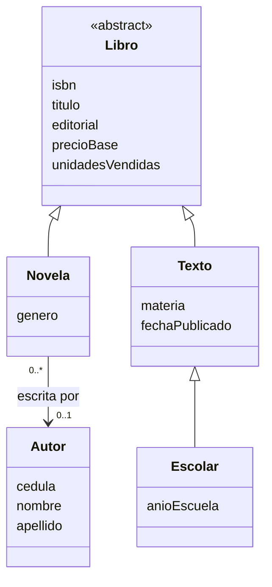
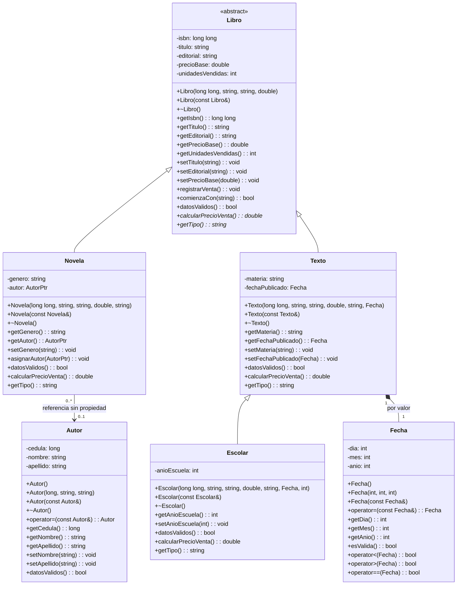
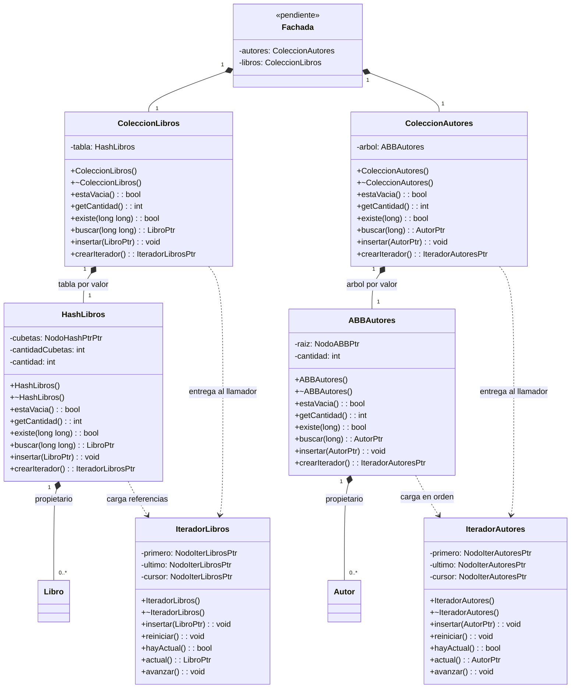
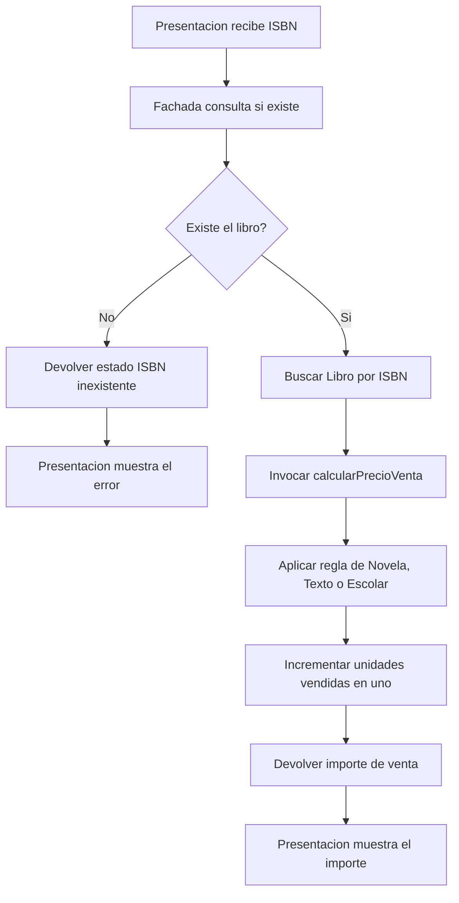

# Obligatorio P4 · Librería

Prototipo en C++ para gestionar libros de autores nacionales, autores de novelas
y ventas. Este README reúne el diseño propuesto y el plan de trabajo del equipo.

> **Estado:** entidades, colecciones e iteradores implementados en la rama local.
> Fachada y menú pendientes. El UML de esas dos capas sigue siendo una propuesta;
> no representa funcionalidades ya disponibles para el usuario.

El ejemplo incremental de Autor incluye constructor, selectores, modificadores,
validación; sus pruebas comparten `tests/main.cpp` con las de Fecha.
Siguiendo las soluciones de los prácticos, los métodos no llevan `const` final
y las comparaciones de Fecha reciben la otra fecha por valor.

## Guía del documento

- [Análisis: qué representa el sistema](#análisis-qué-representa-el-sistema)
- [Diseño: cómo se organiza el código](#diseño-cómo-se-organiza-el-código)
- [Colecciones y estructuras](#colecciones-y-estructuras)
- [Flujo de una venta](#flujo-de-una-venta)
- [Memoria y precondiciones](#memoria-y-precondiciones)
- [Compilación y pruebas](#compilación-y-pruebas)
- [Plan por fases](#plan-por-fases-para-tres-integrantes-sin-fechas)

## Análisis: qué representa el sistema

El diagrama de clases conceptual representa las entidades y sus relaciones.
En esta etapa no aparecen hash, ABB, punteros ni la Fachada. `Libro` es abstracta:
los libros del sistema son novelas o textos; un escolar es un tipo de texto.



Un autor puede estar registrado sin novelas. Una novela puede no tener autor
asociado o tener uno; reemplazar esa asociación no elimina al autor anterior.
No se gestionan clientes, empleados, stock ni respaldo en disco.

## Diseño: cómo se organiza el código

El diagrama de clases de implementación propuesto incorpora tipos, operaciones,
colecciones y la Fachada. Se divide en dos vistas para facilitar su lectura.
Las entidades, colecciones e iteradores reflejan el código; Fachada y presentación
son propuestas pendientes. Para evitar que Mermaid confunda el asterisco de un
puntero con un método abstracto, los diagramas usan `LibroPtr` por `Libro*`,
`AutorPtr` por `Autor*` y `Nodo...Ptr` por el puntero al Nodo privado de esa clase.
`PtrPtr` representa doble puntero. Son abreviaturas gráficas, no clases nuevas.
`ISBN` se representará con `long long` y la cédula con `long`; los textos del dominio
usarán `std::string`. `Fecha` contiene únicamente tres enteros.

### Entidades y polimorfismo



Los métodos abstractos se representan en cursiva. No se usan métodos estáticos.
Son conceptos del teórico; los símbolos usados para generar ese formato pertenecen
al código fuente de Mermaid, no a la notación que se lee en el diagrama.
`Libro` tiene destructor virtual, para liberar correctamente objetos derivados
mediante un puntero a la clase base. Los atributos privados se indican con `-`
y los métodos públicos, incluidos constructores y destructores, con `+`.
Los parámetros se muestran solo con sus tipos. Los métodos con retorno se
escriben como `+metodo(tipos): tipoRetorno`; constructores y destructores no
llevan tipo de retorno. En la implementación C++ sí se nombran los parámetros.
El destructor de Libro es público y virtual; los destructores de las colecciones
son públicos. El signo de visibilidad no indica si un método es virtual.


`getTipo()` devuelve un `string`, siguiendo el patrón `tipoArticulo()`
del Práctico 6: "Novela", "Texto" o "Escolar". Se usará para mostrar o discriminar
resultados. El precio se calcula por polimorfismo, sin comparar esos textos.
Las firmas de entidades, colecciones e iteradores corresponden a los .h actuales.
Las operaciones de Fachada siguen pendientes de especificar e implementar.

| Tipo | Regla de precio de venta |
| --- | --- |
| Novela | Precio base; si el género es infantil, multiplicar por 0,80. |
| Texto | Si fue publicado antes del 01/01/2026, multiplicar el precio base por 0,75. En otro caso, usar el precio base. |
| Escolar | Aplicar el cálculo de Texto; para 1.º a 3.º, multiplicar además por 0,90. |

### Colecciones, estructuras e iteradores

Las colecciones y sus estructuras son clases distintas relacionadas por composición.
Los nodos del hash están dentro de HashLibros y los del árbol dentro de ABBAutores.
Hay solo dos iteradores concretos, independientes de cómo se guarda la colección.



`Ptr` representa un puntero en la vista Mermaid, como se explica en la vista de
entidades. Los constructores de copia y asignaciones de estructuras e iteradores
son privados y no se implementan: estas clases propietarias no se copian.

Fachada sigue pendiente, con un método a especificar por requerimiento. En esa
capa se coordinarán los chequeos y consultas sin leer teclado ni imprimir datos.
El menú y la preparación final de la entrega se trabajarán con el grupo.

## Colecciones y estructuras

Un **TAD** describe operaciones; una **estructura de datos** permite implementarlas.
La colección encapsula su estructura privada. No hace falta que la colección sea
una clase abstracta ni introducir una biblioteca genérica con `templates`.

| Colección | TAD e implementación | Justificación |
| --- | --- | --- |
| Libros | Diccionario por ISBN, hash con encadenamiento | Aproximadamente 500 títulos; búsquedas frecuentes para registrar, asociar autor, consultar y vender (2, 3, 5 y 7). Búsqueda e inserción esperadas O(1) con buena dispersión y carga controlada; peor caso O(n). |
| Autores | Diccionario por cédula, ABB | Cantidad sin cota; búsqueda por cédula y listado ascendente (1, 3 y 6). Búsqueda e inserción O(h), peor caso O(n); recorrido en orden O(n). |

Los 500 títulos son una estimación, no una capacidad máxima. Las cadenas resuelven
colisiones y admiten más elementos. El recorrido completo del hash cuesta
O(n + cantidad de cubetas). La tabla tiene 1009 cubetas y usa ISBN % 1009.
No se redimensiona: las cadenas permiten superar los 500 libros sin un límite fijo
al número de títulos; el costo de búsqueda aumenta si crece mucho la carga.

**ABB es suficiente para esta propuesta:** la letra no exige búsquedas O(log n).
Puede degenerarse con claves ordenadas; AVL garantizaría O(log n), pero requiere
balanceos que no son necesarios para satisfacer los requerimientos.

No se agregan índices por editorial, precio o prefijo: esas consultas pueden recorrer
los libros. Una lista como colección principal haría lineales las búsquedas por
clave. Tampoco hace falta una lista circular para los recorridos finitos pedidos.
En el teórico, LPPF se usa como secuencia con inserción por el final; aquí no hay
un requerimiento que justifique agregar esa secuencia como colección adicional.

**Iteradores:** cada colección prepara una lista de referencias a sus objetos.
Para libros se recorren las cubetas y sus cadenas; para autores se carga la lista
mediante recorrido en orden del ABB. No se copian Libro ni Autor, solo punteros.
Preparar el recorrido cuesta O(n + cubetas) en libros y O(n) en autores, y usa O(n)
nodos auxiliares. Cada paso posterior del iterador cuesta O(1).

El iterador usa punteros al primero y al último para cargar resultados al final
sin invertir el orden: aquí sí se aprovecha una lista con acceso al principio y
al fondo (LPPF). Las listas de colisiones del hash solo insertan al principio.

```cpp
IteradorAutores* iter = autores.crearIterador();
while (iter->hayActual())
{
    Autor* autor = iter->actual();
    // Consultar los datos de autor o agregarlos al resultado de la operación.
    iter->avanzar();
}
delete iter; // Libera nodos auxiliares; los autores siguen en su colección.
```

El recorrido representa los elementos presentes al crearlo. No modificar la
colección durante su uso. Eliminar el iterador antes que la colección y no guardar
sus punteros después de destruirla. Las clases lógicas no imprimen ni leen consola.

**Clases separadas:** ColeccionLibros delega en un HashLibros por valor y
ColeccionAutores delega en un ABBAutores por valor. Las estructuras implementan
los nodos, búsquedas, inserciones, destructores y preparación de recorridos.
Las colecciones conservan una API del dominio independiente de esos detalles.

No existen IteradorHashLibros ni IteradorABBAutores: libros y autores usan una
clase de recorrido concreta cada uno, siguiendo el patrón del Práctico 5.
No se utilizan templates ni clases abstractas adicionales para los iteradores.

## Flujo de una venta

Ejemplo del requerimiento 7: la presentación recibe el ISBN; la Fachada valida,
la colección busca y el libro calcula el precio mediante polimorfismo.



## Memoria y precondiciones

| Elemento | Representación y responsabilidad |
| --- | --- |
| Fecha | Objeto por valor dentro de Texto; no requiere memoria dinámica. |
| Libros | `Libro*` para conservar el polimorfismo. La colección los elimina mediante destructor virtual. |
| Autores | `Autor*` propiedad de su colección. |
| Autor de Novela | Puntero inicialmente nulo, sin propiedad. Reasignarlo no copia ni elimina al autor. |
| Nodos y cubetas | Privados de cada colección; se liberan al destruirla. |
| Iteradores | No poseen los objetos recorridos; quien crea el iterador debe liberarlo. No modificar la colección durante el recorrido. |

Al finalizar se destruyen libros antes que autores. Las colecciones propietarias
no deben copiarse sin definir una política de copia, para evitar dobles liberaciones.
No habrá bajas durante la ejecución, como establece la letra.

### Qué destructores necesitamos

Todas las clases tienen destructor, aunque C++ puede generarlo automáticamente.
Declarar uno propio es necesario cuando debe realizar trabajo específico o ser virtual.

| Clase | Destructor propio en este diseño | Responsabilidad |
| --- | --- | --- |
| Libro | Sí: público y virtual | Permitir `delete` seguro mediante `Libro*`. Su cuerpo puede estar vacío. |
| ColeccionLibros | Público, cuerpo vacío | Al finalizar, su miembro HashLibros se destruye automáticamente; no repite el delete. |
| HashLibros | Sí: público | Elimina cada libro y nodo, y el arreglo de cubetas con delete[]. |
| ColeccionAutores | Público, cuerpo vacío | Al finalizar se destruye su miembro ABBAutores, sin repetir la liberación. |
| ABBAutores | Sí: público | Elimina nodos y autores con recorrido postorden. |
| Novela | Explícito, vacío | Virtual por Libro. No elimina su Autor* prestado. |
| Texto y Escolar | Explícitos, vacíos | Virtuales por herencia. Sus miembros por valor se destruyen automáticamente. |
| Autor | Explícito, vacío | Sigue el estilo del práctico; sus string se destruyen automáticamente. |
| Fecha | No requiere uno escrito a mano | Solo contiene tres enteros. |
| Fachada | No requiere uno escrito a mano con colecciones por valor | Sus colecciones se destruyen automáticamente en orden inverso a su declaración. Declarar autores antes que libros para destruir libros primero. No ejecutar `delete` sobre esos miembros. |
| IteradorLibros | Sí: público | Libera los nodos de su lista de referencias; no elimina libros ni cubetas. |
| IteradorAutores | Sí: público | Libera los nodos de su lista de referencias; no elimina autores ni nodos del ABB. |

La necesidad de liberar los iteradores creados con `new` es independiente de si
su destructor tiene cuerpo propio. Si finalmente se añaden recursos dinámicos
propios a una clase, debe revisarse esta tabla y su política de copia.

Las precondiciones se documentarán en los `.h` con `// PRECONDICION:` y una lista
numerada cuando haya varias. La Fachada debe validar la entrada antes de delegar
una operación que presuponga esos controles.

| Operación | Precondición |
| --- | --- |
| `Fecha(dia, mes, anio)` | Ninguna: guarda los componentes recibidos. Consultar `fecha.esValida()` antes de comparar o incorporar la fecha a un Texto. |
| Comparaciones de Fecha | Ambas fechas son válidas. |
| `buscar(clave)` | La clave existe. Consultar existe(clave) antes de buscar. |
| `insertar(puntero)` | Puntero válido, datos válidos y clave no repetida; devuelve void y transfiere la propiedad a la estructura. Los chequeos se hacen antes. |
| `actual()` y `avanzar()` | `hayActual()` devuelve verdadero. |

## Compilación y pruebas

```text
include/      Encabezados .h
src/          Implementaciones .cpp; main del programa aún vacío
tests/        Main independiente para pruebas
.github/      Workflow de compilación, pruebas y cobertura
```

Desde la raíz del repositorio, en la terminal de Visual Studio Code:

```sh
sh scripts/test.sh
```

El script compila todas las implementaciones de src/ salvo src/main.cpp y ejecuta
el único tests/main.cpp. Finaliza con código distinto de cero si hay un fallo de
compilación o de prueba. No usa sanitizers ni necesita CMake.

La CI utiliza el mismo script con instrumentación de cobertura:

```sh
sh scripts/test.sh --coverage
gcovr --root . --filter 'src/' --merge-lines --fail-under-line 90 build-coverage
```

La cobertura requiere GCC y gcovr 8.5. `--merge-lines` agrupa por línea de fuente
las variantes de constructores que genera el compilador; no excluye clases.
El comando normal no necesita gcovr. En macOS, si se usa GCC de Homebrew, debe
usarse su gcov de la misma versión; el g++ de Apple es Clang y es distinto.
Los nuevos .cpp de src/ se incluyen automáticamente; cada clase nueva necesita
sus casos en el main de pruebas. La configuración de Code::Blocks sigue pendiente.

## Plan por fases para tres integrantes (sin fechas)

Se identifican como A, B y C hasta asignar nombres. Cada entrega incluye sus
pruebas y se integra mediante PR a develop. Se comienza una rama por entregable
a partir de develop actualizado. No se trabaja directamente en develop.

| Fase | Integrante A | Integrante B | Integrante C | Condicion para cerrar la fase |
| --- | --- | --- | --- | --- |
| 1. Acuerdos y base | Fecha: validacion y comparaciones | Autor: datos y consultas | Libro: datos comunes y contrato de precio | Acordar firmas, tipos de claves, resultados de error y propiedad de punteros; probar las tres clases |
| 2. Trabajo paralelo | Novela, Texto y Escolar: precios, fecha y asociacion con Autor | ColeccionAutores con ABB y su iterador | ColeccionLibros con hash y su iterador | Compilar las interfaces acordadas; probar descuentos, orden, duplicados, colisiones y recorridos |
| 3. Operaciones de logica | Consultas de libros: prefijo y detalle (4 y 5) | Registro de autores y listado ordenado (1 y 6) | Registro de libros y asociacion de autor (2 y 3) | Probar operaciones vacias, claves inexistentes y resultados correctos |
| 4. Ventas y consultas agregadas | Ventas y precio final (7) | Recaudacion por editorial y libro mas vendido (8 y 10) | Unidades vendidas por precio y tipo (9) | Probar ventas sucesivas, tipos de libro, ausencia de editorial y empates |


**Integración final entre los tres:** conectar Fachada y menú, revisar los diez
requerimientos, ajustar UML y justificación, y preparar el proyecto Code::Blocks
y el paquete de entrega. Esta etapa no se asigna a una sola persona.

### Como evitar bloqueos y conflictos

- Antes de la fase 2, cerrar juntos las interfaces de Libro, Autor, colecciones
  e iteradores. Los nombres y tipos deben coincidir en las tres ramas.
- Cada integrante implementa contra esos contratos; los cambios de interfaz se
  acuerdan y se integran primero mediante un PR pequeno.
- En fases 3 y 4, escribir y probar cada operacion en el modulo que posee sus
  datos. Un responsable de integracion por fase conecta las llamadas en Fachada:
  A en fase 3 y C en fase 4. Asi no se editan simultaneamente sus mismos metodos.
- Los metodos de Fachada se acuerdan antes de comenzar esas fases. La logica no
  debe depender del menu: el main se conecta al final.
- Agregar pruebas en archivos separados por modulo y mantener un unico main de
  pruebas que las invoque. Actualizar el comando de CI al incorporar archivos
  con implementacion y nuevas pruebas; los archivos reservados vacios no bastan.
- Cada PR debe incluir alcance, precondiciones y pruebas. Otra persona lo revisa;
  la regla obligatoria de aprobacion se activara despues del primer merge acordado.
- Una fase no exige que todos terminen al mismo tiempo: se puede comenzar una
  tarea cuando sus dependencias esten integradas y probadas.

### Criterios de aceptacion por funcionalidad

| Requerimiento | Entregable comprobable |
| --- | --- |
| 1 | Registra autor; rechaza cedula repetida sin modificar la coleccion |
| 2 | Registra cada tipo de libro con cero ventas; rechaza ISBN repetido |
| 3 | Asocia y reemplaza autor; informa claves inexistentes y verifica que sea novela |
| 4 | Filtra por prefijo exacto del titulo y produce datos basicos; detecta resultado vacio |
| 5 | Consulta datos completos por ISBN e incluye autor cuando corresponda |
| 6 | Recorre autores por cedula ascendente; detecta coleccion vacia |
| 7 | Incrementa una venta y devuelve el precio con sus descuentos; rechaza ISBN inexistente |
| 8 | Suma unidades vendidas por precio de venta para la editorial consultada |
| 9 | Suma unidades, no titulos, con precio base estrictamente mayor; separa los tres tipos |
| 10 | Obtiene un libro con ventas maximas de la editorial, incluye detalle y autor; admite cualquier empate |

La eleccion inicial para autores es ABB: la letra no exige operaciones O(log n).
AVL queda como mejora posible, fuera del alcance inicial, si se decide garantizar
ese costo aun con cedulas insertadas en orden.


## Convenciones de las clases implementadas

Fecha incluye constructor por defecto (01/01/2000), común y de copia,
selectores, validación y operadores `<`, `>` y `==`. Usa el enfoque del Práctico 4,
con años entre 1900 y 2099. Se corrige la condición invertida de días que aparece
en su validador. No incluye aritmética de fechas porque el obligatorio no la necesita.

Autor incluye constructor por defecto (cédula cero y textos vacíos), común y de
copia, selectores y modificadores de nombre y apellido. El autor por
defecto no es válido hasta contar con datos completos. No se modifica su cédula
una vez registrado porque es clave del diccionario. Su validación es una consulta
sobre el objeto, siguiendo el patrón de Fecha.

Los parámetros se nombran en el .cpp y se omiten en el .h. Los constructores de copia
reciben `const Clase&`, como en los prácticos. Autor y Fecha también definen
operator= explícito, para acompañar su constructor de copia y evitar los avisos
del compilador sobre asignación implícita. No se usan métodos static ni const
final. Fecha conserva destructor automático. Autor y las derivadas de Libro
escriben destructor vacío siguiendo el estilo del Práctico 6; los atributos objeto
se destruyen automáticamente. HashLibros y ABBAutores liberan los recursos que
poseen, y los destructores de sus colecciones dejan actuar a esos miembros por valor.
